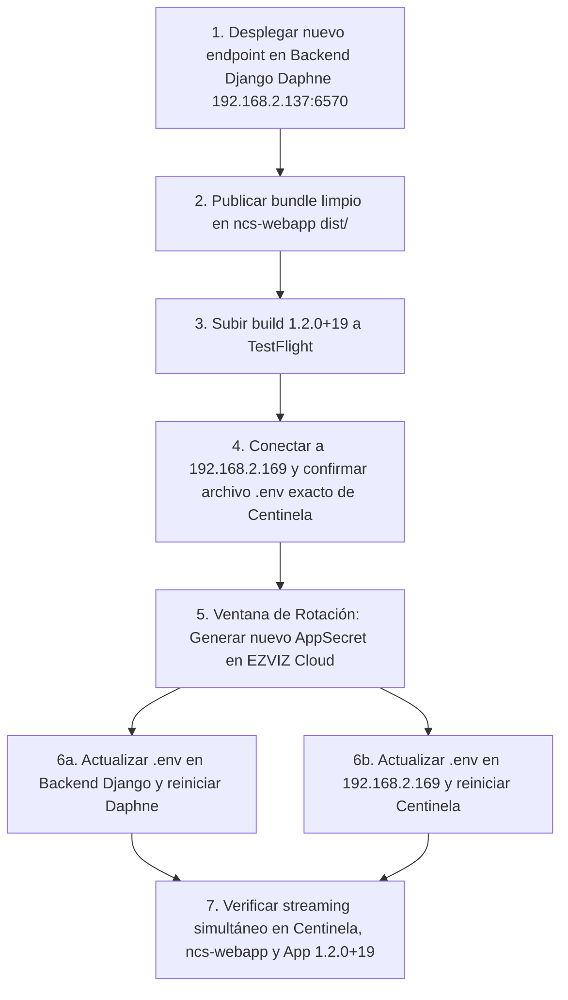

# Plan Maestro de Seguridad, Despliegue y Rotación de Credenciales EZVIZ

## 1. Exposición Histórica y Versiones Reales del Proyecto

- **Versión Real del Proyecto Móvil:**
  - En `pubspec.yaml` de la app Flutter, la versión establecida para la próxima compilación es **`1.2.0+19`**.
  - *Aclaración técnica:* Se mencionó anteriormente la denominación informal "v4.4.x" tomando erróneamente el nombre de la carpeta raíz del workspace (`NCS 4.4 APP`, correspondiente al ciclo de release corporativo 4.4 de Naviera Cruz del Sur). Por otro lado, `pubspec.yaml` contenía históricamente `1.1.0+3` debido a que las subidas previas a TestFlight (versión 1.2, build 18) fueron generadas pasando argumentos de compilación por consola (`--build-name=1.2 --build-number=18`) o en Xcode sin haber sido commiteadas al repositorio central.
  - La nueva compilación a distribuir en TestFlight parte estrictamente del código vigente y se etiqueta como **`1.2.0+19`** (superior a la build 18).
- **Confirmación de Exposición en Builds Anteriores:**
  - Las constantes maestras `_appKey` y `_appSecret` fueron compiladas en todas las builds móviles anteriores subidas a TestFlight (`build 1` a `build 18`).
  - Quitar el secreto en la nueva build `1.2.0+19` **no revoca el secreto de las builds viejas ya instaladas**. La única forma de extinguir el riesgo es rotar la credencial en la plataforma EZVIZ Cloud.
- **Cierre de Exposición en NCS WebApp (Versión Web React de la App Móvil):**
  - Se eliminó el secreto de `ncs-webapp/src/pages/Fleet.jsx`. Esta versión web ahora consulta el backend corporativo Django autenticado con token de sesión de usuario, igual que la app móvil.
  - Se eliminaron las variables `VITE_EZVIZ_APP_KEY` y `VITE_EZVIZ_APP_SECRET` de `.env` y `.env.production`. **Nunca debe usarse el prefijo `VITE_*` para secretos**, ya que el compilador Vite los incrusta en texto plano en los bundles JavaScript descargados por los navegadores.
  - Se purgó el directorio `ncs-webapp/dist/` y se recompiló el frontend limpio (`dist/assets/*.js` verificado con 0 ocurrencias de secretos).
  - *Aclaración:* La Intranet Corporativa real opera de forma independiente en `192.168.2.137:443` (Laravel / Nginx) y queda completamente fuera del alcance de esta tarea.

---

## 2. Política de Vencimientos, TTL y Resiliencia de Sesiones

Para evitar desconexiones imprevistas y sobrecarga de peticiones, se definen los siguientes criterios basados en la información oficial provista por EZVIZ:

| Recurso | Tiempo Informado por EZVIZ | Margen de Seguridad Aplicado | TTL Efectivo en Caché | Criterio ante Ausencia de Dato | Manejo de Sesión Inválida |
| :--- | :--- | :--- | :--- | :--- | :--- |
| **Token de Acceso (`/token/get`)** | `expireTime` en milisegundos (típicamente 7 días = 604.800 s). | **12 horas antes** de expirar (`expireTime - 43.200 s`). | ~6.5 días | Si EZVIZ no informa `expireTime`, TTL por defecto de 24 horas. | Si EZVIZ devuelve error `10001` o `10002` (token expirado/inválido), se purga la caché inmediatamente, se reautentica y se reintenta la petición. |
| **Enlace HLS Stream (`.m3u8`)** | Parámetro `expire=` en URL y campo `expireTime` (típicamente 24 horas). | **30 minutos antes** de expirar (`expire - 1.800 s`). | ~23.5 horas | Si EZVIZ no informa vencimiento, TTL por defecto de 2 horas. | Si el cliente reporta fallo de reproducción (`CameraPlayerStatus.error`), la app **invalida de inmediato** el enlace de esa cámara en memoria, forzando la renovación fresca sin esperar al vencimiento. |

---

## 3. Realidad Técnica sobre la Rotación en EZVIZ Cloud

Conforme a la documentación técnica de la API de EZVIZ Open Cloud:
1. **No existe "Doble Secreto Activo":**
   La consola de EZVIZ Open Cloud no dispone de período de gracia con dos secretos válidos simultáneos. Al hacer clic en "Reset Secret", el secreto anterior es reemplazado de inmediato para la emisión de nuevos tokens.
2. **Comportamiento de Tokens y Enlaces ya Emitidos:**
   - Cambiar el `AppSecret` en la consola de EZVIZ **NO invalida de forma inmediata los `accessTokens` ya generados** ni los enlaces HLS firmados que están en reproducción.
   - Los `accessTokens` son gestionados en la capa de sesión de EZVIZ y permanecen activos hasta alcanzar su `expireTime` (hasta 7 días).
   - Las transmisiones HLS firmadas continúan resolviéndose en los servidores de medios de borde (Edge VTMS) hasta que expira el parámetro `expire=`.
   - Por tanto, la rotación anula de inmediato la capacidad de generar **nuevos** tokens con las credenciales viejas, pero no revoca instantáneamente los tokens ni streams ya emitidos.
3. **Plan de Minimización de Impacto:**
   Dado que no hay soporte de doble secreto, la actualización de los archivos `.env` en los servidores debe coordinarse en una ventana de mantenimiento breve (menos de 2 minutos).

---

## 4. Mapa Real de Servidores y Componentes a Desplegar

### Distinción Fundamental de Servidores en LAN
- **Servidor Activo Centinela NOC (`192.168.2.169`):**
  - Es la **única máquina activa** donde opera el sistema Centinela (servicios web y puente de cámaras).
- **Servidor Local / Entorno Actual (`192.168.2.9` / `ARBUENCS-SRV03`):**
  - Es el servidor de desarrollo y XAMPP donde se compila el código y reside este entorno.
  - La carpeta histórica de análisis de video encontrada en esta máquina **es una copia inactiva y NO es la instalación activa**.
  - **REGLA ESTRICTA:** No modificar, reiniciar ni detener procesos en la `.9` vinculados a Centinela.
- **Dirección Obsoleta (`192.168.2.121`):**
  - Dirección IP histórica presente en antiguos scripts de puente (`conexion_centinela.js`, `vite.config.js`). No responde en red y **no aloja Centinela**. Ha sido corregida en todo el repositorio.

---

### Matriz de Diferenciación Arquitectónica de Flujos

Para garantizar que la corrección de cámaras no altere las funcionalidades existentes, se establecen claramente las responsabilidades de cada componente:

| Flujo / Funcionalidad | Proveedor / Host | Ruta / Endpoint de Red | Proxy en Intranet | Destinatarios | Regla de Conservación |
| :--- | :--- | :--- | :--- | :--- | :--- |
| **Mapa y Telemetría de Flota** | **Centinela NOC** (`192.168.2.169`) | `/api/radar-targets`<br>`/api/telemetry`<br>`/api/vessels`<br>`/api/weather` | `/centinela-api/*`<br>hacia `https://192.168.2.169:5073` | Intranet Web, Monitoreo NOC | **CONSERVAR INTACTO:** No redirigir al Django backend. Centinela sigue siendo el proveedor de la cartografía y posiciones. |
| **Asistente y Chat IA** | **Centinela IA** (`192.168.2.169`) | `/api/ai-chat/external-bot`<br>(con cabecera `x-api-key`) | `/centinela-api/api/ai-chat/external-bot` | App Flutter (`NCSChatService`), Intranet (`AIChat.jsx`) | **CONSERVAR INTACTO:** Consulta directa al puerto 3001 / 5073 de la .169. |
| **Cámaras en Vivo (Streaming HLS)** | **Backend Central Django** (`navieracruzdelsur.dyndns.org:6570`) | `/api/v1/cameras/<id>/live-url/`<br>(autenticado por Token/Sesión) | `/api/v1/cameras/...`<br>hacia el backend Daphne | App Flutter (build 19), Intranet (`Fleet.jsx`) | **NUEVO CIRCUITO SEGURO:** Es el único flujo modificado para aislar las credenciales maestras de EZVIZ fuera de los clientes. Centinela conserva sus propias cámaras internas para su consola. |

---

### Detalle de Servidores del Ecosistema

#### Servidor 1: Backend Central de la App (`192.168.2.137:6570` / `navieracruzdelsur.dyndns.org:6570` - ARBUENCS-SRV02)
- **Host y SO:** `ARBUENCS-SRV02` (IP local: `192.168.2.137`, IP pública: `201.216.210.211`).
- **Ruta Raíz del Proyecto:**
  `C:\Users\ARBUENCS-SRV02\OneDrive - Naviera Cruz del Sur\Escritorio\python\intranet_django3`
- **Ubicación de manage.py:**
  `C:\Users\ARBUENCS-SRV02\OneDrive - Naviera Cruz del Sur\Escritorio\python\intranet_django3\manage.py`
- **Entorno Virtual Python:**
  `C:\Users\ARBUENCS-SRV02\OneDrive - Naviera Cruz del Sur\Escritorio\python\intranet_django3\venv`
- **Django Settings:** `intranet_django2.settings.naviera`
- **Módulo ASGI:** `intranet_django2.asgi:application`
- **Proceso y Supervisión:**
  - Corre mediante consola interactiva ejecutando: `"Naviera Intranet Daphne SSL.bat"`
  - Comando que corre el script:
    `venv\Scripts\daphne.exe -t 300 -e "ssl:6570:privateKey=cert/navieracruzdelsur.dyndns.org-key.pem:certKey=cert/navieracruzdelsur.dyndns.org-crt.pem" intranet_django2.asgi:application`
- **Archivos a desplegar en el servidor:**
  1. Copiar `camera_live_views.py` en:
     `C:\Users\ARBUENCS-SRV02\OneDrive - Naviera Cruz del Sur\Escritorio\python\intranet_django3\intranet\api\camera_live_views.py`
  2. Copiar `test_camera_live_views_django.py` en:
     `C:\Users\ARBUENCS-SRV02\OneDrive - Naviera Cruz del Sur\Escritorio\python\intranet_django3\intranet\api\tests\test_camera_live_views.py`
  3. Registrar las dos rutas en:
     `C:\Users\ARBUENCS-SRV02\OneDrive - Naviera Cruz del Sur\Escritorio\python\intranet_django3\intranet\api\urls.py`
     ```python
     from .camera_live_views import CameraLiveStreamView

     # Dentro de urlpatterns:
     path('cameras/<int:camera_id>/live-url/', CameraLiveStreamView.as_view(), name='camera-live-url-by-id'),
     path('cameras/<str:camera_id>/live-url/', CameraLiveStreamView.as_view(), name='camera-live-url-by-serial'),
     ```
- **Configuración de Variables de Entorno (.env):**
  - Archivo: `C:\Users\ARBUENCS-SRV02\OneDrive - Naviera Cruz del Sur\Escritorio\python\intranet_django3\.env`
  - Agregar al final (conservando por ahora las credenciales vigentes sin rotar):
    ```env
    EZVIZ_APP_KEY=tu_app_key_actual
    EZVIZ_APP_SECRET=tu_app_secret_actual
    ```
- **Ejecución de la Suite de Pruebas Oficial en Django (Antes de reiniciar Daphne):**
  - Abrir terminal en la raíz `C:\Users\ARBUENCS-SRV02\OneDrive - Naviera Cruz del Sur\Escritorio\python\intranet_django3` y ejecutar:
    ```cmd
    venv\Scripts\python.exe manage.py test intranet.api.tests.test_camera_live_views --settings=intranet_django2.settings.naviera
    ```
  - Confirma contra la base de datos real que los modelos `Ship` y `Camera` de la app `intranet` resuelven correctamente y que el control de acceso (RBAC) está blindado.
- **Procedimiento de Reinicio de Daphne:**
  1. Cerrar la ventana de consola donde corre `"Naviera Intranet Daphne SSL.bat"` (o matar el proceso en el puerto 6570).
  2. Ejecutar nuevamente el archivo `"Naviera Intranet Daphne SSL.bat"`.
- **Verificación HTTPS con Certificado Válido (Sin `-k`):**
  - Realizar una solicitud con validación estricta de TLS desde cualquier equipo con acceso a la red:
    ```bash
    curl -H "Authorization: Token <token_usuario>" https://navieracruzdelsur.dyndns.org:6570/api/v1/cameras/10012/live-url/
    ```
  - Validar también con el serial:
    ```bash
    curl -H "Authorization: Token <token_usuario>" https://navieracruzdelsur.dyndns.org:6570/api/v1/cameras/BF1765385/live-url/
    ```
  - Ambas deben responder `HTTP 200 OK` con JSON:
    `{"status": "online", "url": "https://vtms...", "expires_at": "...", "device_serial": "BF1765385", "ship_code": "alfa", "ship_name": "ALFA C"}`
- **Procedimiento de Reversión Inmediata (Rollback Plan):**
  Si se detectara cualquier inconveniente:
  1. Comentar las dos líneas de `cameras/.../live-url/` en `intranet/api/urls.py`.
  2. Reiniciar Daphne cerrando y abriendo `"Naviera Intranet Daphne SSL.bat"`.
  3. El servidor vuelve al 100% de su estado anterior en menos de 30 segundos sin alterar Centinela ni la Intranet Laravel.

#### Servidor 2: NCS WebApp - Versión Web de la App Móvil (`192.168.2.9:2223` / `dist/`)
- **Rol:** Es la versión web en React de la app móvil. **No es la Intranet Corporativa**.
- **Archivos desplegados:**
  - Código fuente en `ncs-webapp/`.
  - Bundle limpio compilado en `ncs-webapp/dist/` (sin secretos).
  - Proxy de desarrollo en `vite.config.js`:
    - `/api/v1` -> hacia backend Daphne `https://navieracruzdelsur.dyndns.org:6570`.
    - `/centinela-api` -> hacia Centinela `https://192.168.2.169:5073`.

#### Intranet Corporativa Real (`192.168.2.137:443`) - FUERA DE ALCANCE
- **Rol:** Sistema web independiente en Laravel / PHP servido por Nginx.
- **Estado:** Queda completamente fuera de esta tarea. No se modifica su código ni su integración con el mapa de Centinela.

#### Servidor 3: Servidor Real Centinela NOC (`192.168.2.169`)
- **Servicios de red comprobados desde el entorno:**
  - Puerto `3001` (Backend Node.js Express de Centinela - API `/api/cameras`, respondiendo tokens y streaming).
  - Puerto `3000` (Frontend Vite de Centinela).
  - Puerto `5073` (Puente seguro HTTPS Express).
  - Puerto `8000` (FastAPI / Uvicorn - NCS AI Control Center API).
  - Puerto `3389` (Escritorio Remoto Windows RDP - abierto y listo para conexión).
- **Estado de Comprobación Interna:**
  - **PENDIENTE EN MÁQUINA:** La comprobación de la ruta exacta en disco, el proceso/PID en ejecución y el archivo de configuración `.env` efectivo **queda pendiente** porque este entorno (`192.168.2.9`) no posee acceso administrativo por shell ni sistema de archivos remoto a `192.168.2.169` (puertos SMB 445 y WinRM 5985 cerrados/bloqueados).
  - **No se presenta ninguna ruta inferida como verificada.**

#### App Móvil iOS / Android
- **Build oficial:** `naviera_cruz_app` versión **`1.2.0+19`**.
- **Estado:** Código libre de credenciales, consulta exclusiva al backend autenticado, circuit breaker, soporte de `?refresh=true` upstream y badges con estados reales.
- **Criterio de Tráfico de Red:**
  - **Autenticación y Obtención de Enlace:** La app consulta **exclusivamente al backend corporativo** (`https://navieracruzdelsur.dyndns.org:6570/api/v1/cameras/<id>/live-url/`). Jamás invoca endpoints de autenticación de EZVIZ (`open.ezvizlife.com`) ni contiene `appSecret`.
  - **Reproducción Multimedia:** Una vez recibida la URL segura `.m3u8`, el reproductor de video (AVPlayer en iOS / ExoPlayer en Android) descarga los fragmentos de video directamente desde los servidores de distribución de medios de EZVIZ (Edge VTMS, ej. `vtmsaopaulo.ezvizlife.com:4443`).
- **Acción:** Generar IPA en macOS y distribuir a TestFlight para reemplazar la build 18.

---

## 5. Procedimiento de Verificación en `192.168.2.169` (Vía RDP - Solo Lectura)

Para identificar la configuración efectiva de Centinela **antes** de rotar el secreto, sin realizar escrituras ni recorrer el disco completo, el administrador debe conectarse por RDP a `192.168.2.169:3389` y ejecutar en PowerShell:

```powershell
# =====================================================================
# AUDITORIA DE SOLO LECTURA: CENTINELA EN 192.168.2.169
# =====================================================================

# 1. Identificar el proceso activo escuchando en el puerto 3001
$conn = Get-NetTCPConnection -LocalPort 3001 -State Listen -ErrorAction SilentlyContinue | Select-Object -First 1
if (-not $conn) {
    Write-Host "Puerto 3001 no detectado en escucha." -ForegroundColor Red
    return
}
$proc = Get-CimInstance Win32_Process -Filter "ProcessId = $($conn.OwningProcess)"

Write-Host "=== PROCESO EN PUERTO 3001 ===" -ForegroundColor Green
Write-Host "PID: $($proc.ProcessId)"
Write-Host "Ejecutable: $($proc.ExecutablePath)"
Write-Host "Linea de comando: $($proc.CommandLine)"

# 2. Localizar la carpeta activa del proyecto (sin escanear todo el disco)
$appDir = $null
if ($proc.CommandLine) {
    $tokens = $proc.CommandLine -split '\s+'
    foreach ($token in $tokens) {
        $clean = $token.Trim('"', "'")
        if ($clean -match '^[a-zA-Z]:\\.*(?:\.js|\.mjs|\.cjs|\.ts)$' -and (Test-Path $clean)) {
            $appDir = Split-Path -Path $clean -Parent
            Write-Host "`nCarpeta activa identificada: $appDir" -ForegroundColor Green
            break
        }
    }
}
if (-not $appDir -and $proc.ExecutablePath) {
    $appDir = Split-Path -Path $proc.ExecutablePath -Parent
    Write-Host "`nCarpeta deducida del ejecutable: $appDir" -ForegroundColor Yellow
}

# 3. Comprobar variables de entorno del sistema que puedan sustituir al .env
Write-Host "`n=== VARIABLES DE ENTORNO EN EL SISTEMA (SOLO NOMBRES) ===" -ForegroundColor Cyan
$sysVars = [System.Environment]::GetEnvironmentVariables('Machine')
$userVars = [System.Environment]::GetEnvironmentVariables('User')
$envKeys = @($sysVars.Keys) + @($userVars.Keys) | Select-Object -Unique | Where-Object { $_ -match "EZVIZ|APP_KEY|APP_SECRET|CAMERA" }
if ($envKeys) {
    foreach ($k in $envKeys) {
        Write-Host "  - Variable detectada en SO: $k [CONFIGURADA]" -ForegroundColor Yellow
    }
} else {
    Write-Host "No existen variables de EZVIZ a nivel de Sistema/Usuario." -ForegroundColor Gray
}

# 4. Inspeccionar archivos de configuracion LIMITADOS EXCLUSIVAMENTE a la carpeta activa
Write-Host "`n=== ARCHIVOS DE CONFIGURACION EN LA CARPETA ACTIVA (ENMASCARADO) ===" -ForegroundColor Cyan
if ($appDir -and (Test-Path $appDir)) {
    Get-ChildItem -Path $appDir -Filter ".env*" -File -ErrorAction SilentlyContinue | ForEach-Object {
        Write-Host "`nArchivo: $($_.FullName)" -ForegroundColor Green
        Get-Content $_.FullName | ForEach-Object {
            $line = $_.Trim()
            if ($line -match '^([^#=]+)=(.*)$') {
                $k = $matches[1].Trim()
                $v = $matches[2].Trim()
                if ($k -match "KEY|SECRET|TOKEN|PASS|AUTH") {
                    Write-Host "  $k = [PRESENTE - Longitud: $($v.Length) caracteres]" -ForegroundColor Yellow
                } else {
                    Write-Host "  $k = $v" -ForegroundColor Gray
                }
            }
        }
    }
}

# 5. Metodo de inicio (PM2 / Servicio Windows)
Write-Host "`n=== SUPERVISION DE PROCESO ===" -ForegroundColor Cyan
if (Get-Process pm2 -ErrorAction SilentlyContinue) {
    Write-Host "PM2 activo:" -ForegroundColor Green
    pm2 list
}
Get-Service | Where-Object { $_.DisplayName -match "Centinela|Node" } | Select-Object Name, DisplayName, Status, StartType
```

---

## 6. Orden de Ejecución para la Rotación Definitiva




1. **Paso 1:** Desplegar el endpoint `/api/v1/cameras/<camera_id>/live-url/` en el backend Django (`navieracruzdelsur.dyndns.org:6570`) con el secreto actual en `.env` y reiniciar Daphne.
2. **Paso 2:** Desplegar la versión web limpia de la app móvil (`ncs-webapp/dist/`). La intranet real (`192.168.2.137:443`) no se toca.
3. **Paso 3:** Subir y aprobar la versión `1.2.0+19` en TestFlight.
4. **Paso 4:** Conectar vía RDP a `192.168.2.169`, ejecutar los comandos de auditoría para certificar la ruta del proyecto Centinela y el archivo `.env` efectivo.
5. **Paso 5 (Momento de Rotación):** En la consola de EZVIZ Cloud, regenerar el `AppSecret`.
6. **Paso 6:** En simultáneo (ventana < 2 minutos):
   - Backend Django Daphne (`.env`) -> reiniciar Daphne.
   - En `192.168.2.169` -> actualizar el nuevo `AppSecret` en el `.env` identificado y reiniciar el proceso Node.js.
7. **Paso 7:** Validar el streaming de ALFA C, NANY y GUSTAVO U en Centinela, ncs-webapp y la app móvil. A partir de ese momento, cualquier build móvil anterior que intente pedir tokens nuevos con la clave expuesta será bloqueada por EZVIZ.

